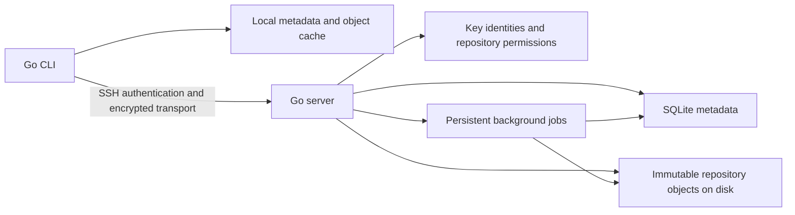

# Crease project plan and architecture

Status: implemented as an initial Go CLI and self-hosted SSH server, including packed durable writes, compressed binary streams, blob deltas, incremental tracking and tree updates, compact workspace and object indexes, an optional native filesystem monitor, and reusable history validation. See [README.md](README.md) for working commands and current limits, [docs/FORMAT.md](docs/FORMAT.md) for the formats, and [docs/PERFORMANCE.md](docs/PERFORMANCE.md) for measurements. This document preserves the intended architecture and delivery milestones. Large-scale performance validation and the optional web interface remain follow-up work.

## Product direction

Crease is a private, self-hosted version-control system written in Go. Developers install a CLI, create or clone a repository, make local commits, and synchronize with a server they control. The server runs on a VPS, EC2 instance, or another machine with persistent storage.

The project borrows Git's commits, branches, history, and review workflow. It defines its own repository format and network protocol. A standard Git client will not be able to clone a Crease repository in the first release.

The first release should provide:

- One downloadable binary with client and server commands.
- SSH public-key authentication without a hosted account or browser login.
- Local commits, history, status, and diffs that work offline with available objects.
- Private repositories with read, write, and admin permissions.
- Synchronization that transfers missing objects in batches.
- Pull requests, reviews, and a merge queue stored on the server.
- Ordinary tracking of `.env` files and other secrets when the owner chooses to include them.

Speed must come from avoiding unnecessary transfer, scans, and recomputation. Using Go or SQLite alone does not establish a performance advantage over Git.

## Trust and privacy

Version one uses a trusted-server model. Repository owners trust the server administrator and the machines holding repository copies.

SSH authenticates clients and encrypts network traffic. It does not encrypt repository contents on disk. The server can read stored files, including tracked secrets. Owners can use encrypted volumes and encrypted backups for storage protection.

There is no public or anonymous repository access. Each collaborator keeps their own private key, and an administrator grants access using that person's public key. The application never needs a collaborator's private key on the server.

Removing a key blocks future server requests. It cannot erase existing clones or downloaded credentials. Credentials must be rotated when their former holders should no longer be able to use them.

Automatic encryption of selected tracked files is a possible later feature. It requires a separate design for key distribution, recovery, rotation, diffs, and merges. Do not describe SSH authentication as end-to-end encryption of stored files.

## Intended developer experience

### Start a server

Copy the binary and the owner's public key to the server, then run:

```sh
crease serve \
  --data /var/lib/crease \
  --listen :2222 \
  --owner-key ./owner.pub
```

On first initialization, the server creates its persistent SSH host key and registers the initial owner. Once initialized, changing the bootstrap flag must not replace the owner or reset access rules. Subsequent administration requires an authorized identity or deliberate local recovery by the server operator.

Run the process under systemd for a persistent Linux deployment. Keep data outside the installation directory so replacing the binary does not replace repositories.

### Create and publish a repository

```sh
crease create ssh://your-server:2222/my-project
cd my-project

# Create or edit project files.
crease add .
crease status
crease commit -m "Initial version"
crease push
```

`create` creates the remote repository and its local workspace. The first implementation can reserve repository creation for the server owner. `init` creates a local-only repository, and a remote can be attached later.

`add` marks files as tracked. Version one has no separate staging area or partial-file staging: `commit` snapshots all tracked changes, including deletions. Status and help must make this behavior clear.

`.creaseignore` excludes untracked paths from discovery and bulk additions. Already tracked paths remain tracked until explicitly removed from tracking. `.env` files are permitted; users choose whether to track or ignore them. Internal `.crease` state can never be tracked.

### Clone and work on another machine

```sh
crease clone ssh://your-server:2222/my-project
cd my-project

crease branch create feature/login
# Edit files.
crease commit -m "Add login flow"
crease push
```

The client uses an existing OpenSSH-compatible key or SSH agent. It verifies the server host-key fingerprint on the first connection, remembers it, and rejects unexpected changes. A local key passphrase may still be needed when an agent has not unlocked the key.

### Grant repository access

From a workspace, using a repository administrator's identity:

```sh
crease access grant ./teammate.pub --role write
crease access list
crease access revoke ./teammate.pub
```

Permission levels:

| Role | Allowed operations |
| --- | --- |
| Read | Clone, fetch, browse history, and read reviews |
| Write | Read access plus push branches, open pull requests, and submit reviews |
| Admin | Write access plus manage repository access and merge policies |

The server owner is a separate administrative authority. Repository administrators cannot grant themselves server-owner privileges.

### Review and merge

```sh
crease pr create --base main --title "Add login flow"
crease pr list
crease pr diff 42
crease pr approve 42
crease pr merge 42
```

These commands use the same authenticated connection as repository synchronization. A web review interface can follow after the CLI workflow works.

## System architecture



One binary exposes `crease serve` and the client commands. Client and server share the object format, graph operations, diff logic, and protocol types. Storage, transport, and CLI formatting stay separate from those packages.

The initial deployment is one server process with a local persistent disk. Multiple server instances sharing a database, geographic replication, and high availability are outside the first release.

### Repository data model

| Record | Contents | Mutability |
| --- | --- | --- |
| Blob | File contents | Immutable |
| Tree | Sorted path entries, supported file modes, and object references | Immutable |
| Commit | Root tree, ordered parent IDs, author, timestamp, and message | Immutable |
| Branch | Repository-scoped name and current commit ID | Mutable |
| Pull request | Stable ID, source branch, target branch, description, and state | Mutable, with recorded revisions |
| Review | Reviewer identity, reviewed revision, decision, and comments | Decisions tied to a specific revision |

Object IDs use SHA-256 over a defined, versioned encoding that includes the object type and payload length. The encoding must be deterministic across platforms. A format specification and fixed test vectors come before the format is treated as stable.

Each commit describes a full snapshot through its root tree. Unchanged blobs and subtrees are reused, so a new commit does not copy the entire repository. Histories form a directed acyclic graph, with merge commits referencing both parents.

Commit author fields describe authorship; they are not proof of identity. The server separately records which authenticated key pushed a branch update. Signed commits are a later feature.

### Local storage

```text
my-project/
  .crease/
    config
    state.db
    objects/
  .creaseignore
  application files...
```

Local SQLite stores tracked paths, file metadata, the current branch, branch references, remote configuration, fetched history frontiers, and workspace operation state. Objects live in a separate content-addressed directory. Writers batch new objects into binary packs and flush them before publishing references. Snapshot and decoded metadata caches avoid repeated work within a command; tracking updates write only added or removed paths.

Start with a complete checkout of the selected branch's current snapshot. Historical blobs can be fetched on demand after partial-history support is implemented. Users must be able to prefetch required data before going offline; a missing uncached object should produce a clear error while offline.

Use a filesystem metadata cache to reduce repeated hashing, with conservative invalidation and a full-scan fallback. The optional native monitor accelerates warm commands, with full scans after restarts or event loss and whenever monitoring is unavailable.

### Server storage

```text
/var/lib/crease/
  server.db
  host_key
  repositories/
    <repository-id>/
      objects/
      uploads/
```

SQLite stores repository records, key identities, grants, branch references, pull requests, comments, review revisions, audit events, and jobs. Repository-scoped graph proofs record history the server has already validated. Binary object packs store source contents and immutable history, with compression and bounded blob deltas.

Use short database transactions. Hashing, compression, diff generation, and network transfer happen outside write transactions. SQLite serializes writers, so sustained write contention must be measured. Move to a client/server database if deployment or workload requirements justify it.

Keep object storage behind an interface for later object-storage support. Initially scope it to each repository. Neither deduplication nor knowledge of an object ID grants access to another repository's objects.

### SSH transport and authentication

Use Go's maintained `golang.org/x/crypto/ssh` implementation with supported algorithms. Prefer Ed25519 user and host keys for the initial setup, while leaving room for other supported key types.

The embedded SSH service accepts a fixed repository RPC command. It does not provide a shell, arbitrary command execution, port forwarding, or SFTP. After authentication, the session carries the authenticated identity into each operation's permission check.

Define a versioned application protocol over the SSH channel. Use bounded, length-prefixed request metadata and streamed object batches. Negotiate capabilities and reject unsupported versions clearly. Set request, object-size, and concurrency limits.

Object reads, branch updates, pull-request operations, and access administration all require repository authorization. An object-fetch endpoint must not become a way to read private objects by guessing or obtaining their IDs.

### Synchronization

Keep object transfer separate from branch updates:

1. Authenticate and authorize access to the repository.
2. Exchange branch references and the object inventory needed for the requested operation.
3. Transfer missing objects in bounded batches, with integrity verification.
4. Make uploaded objects durable and verify the proposed commit graph is complete.
5. Update the branch transactionally, checking that its old value still matches the client's expected value.
6. Acknowledge success only after the branch update is durable.

Concurrent pushes must not silently overwrite each other. Normal pushes require a fast-forward update. Force updates are deferred until their policy and recovery behavior are defined.

`fetch` updates remote information without editing workspace files. `pull` fetches and fast-forwards the current branch when possible. A diverged branch requires an explicit merge. A checkout or pull that would overwrite local edits must stop with a useful explanation.

Retrying an interrupted upload must safely reuse verified objects. Mutations such as repository creation and pull-request creation need idempotency identifiers so a lost response does not create duplicates.

### Crash safety and recovery

Write each object to a temporary file, verify it, flush it, and atomically publish it. Complete the required file and directory durability steps before a database reference can point to it. A crash may leave unreferenced objects; it must not leave an acknowledged branch pointing to missing data.

Workspace updates need a recoverable operation journal. An interrupted checkout must be detectable and recoverable without discarding edits silently.

Record branch movements so administrators can recover from mistakes. Delay garbage collection until retention rules exist for branches, open reviews, operation history, and active uploads. A background cleanup must not race with a push and delete its objects.

Back up SQLite through a consistent backup mechanism and preserve every object referenced by that snapshot. Hold garbage collection during backup or use an equivalent retention barrier. Document and test restoration on a clean server, including SSH host identity and access grants.

## Pull requests and merging

A pull request has a stable ID independent of its current source commit. Each revision records the source commit and comparison base. Comments retain their original revision and location when later edits make them outdated.

Cache diffs by the exact compared commit IDs and diff options. Paginate lists and discussion threads. Generate expensive diffs through bounded workers rather than during every list request.

Start with three-way text merging using a merge base. Preserve both parents in merge commits. Report overlapping edits and unsupported cases explicitly. Initial limitations include manual resolution for binary changes, no automatic rename detection, and no automatic handling of ambiguous multiple merge bases.

The merge queue computes a candidate against the current target head. Reviews apply to a source revision; required checks apply to the exact candidate being merged. If the source changes, invalidate its approval according to policy. If the target changes, rebuild and recheck the candidate before publishing it.

Start with manual approval and an internal merge job. Define authenticated external check reporting when CI integration is added. Enqueueing a merge is not the same as completing it; the CLI should expose queued, checking, conflicted, failed, and merged states.

## Performance plan

Thousands of open pull requests should primarily increase indexed metadata, not the size of every clone. Listing reviews must not generate their full diffs, and source synchronization must not download unrelated review branches or discussions.

Measure these operations separately:

| Operation | Measurements |
| --- | --- |
| Cold clone | Time to usable workspace, bytes transferred, disk use, peak memory |
| Incremental push and pull | Latency, transferred bytes, object count, retries |
| Status and commit | Files scanned, files hashed, elapsed time, peak memory |
| Review list and diff | Median and p95 latency, cache behavior, query cost |
| Merge queue | Throughput, queue time, conflicts, work repeated after target changes |
| Server concurrency | Database lock time, CPU, memory, disk I/O, rejected requests |

Benchmark fixtures should include a small source repository, 100,000 tracked paths, large binary files, deep history, 10,000 open pull requests, and concurrent clients. These are test workloads, not promised capacities. Record hardware, network conditions, file sizes, and cache state with results.

Compare equivalent operations against Git configured for the same working set, including partial clone and sparse checkout where relevant. Establish measured targets before claiming a speed improvement.

The implemented optimizations batch durable pack writes, reuse snapshots and tracking rows, stream history metadata, stop inventory and validation at known history, and compress binary records with optional blob deltas. They retain durable reference publication and hash validation at object ingestion. Local commands also use compact workspace and consolidated object indexes, incremental tree updates, changed-file diff retrieval, and a bounded Myers comparison with context hunks. An optional native filesystem monitor narrows filesystem scans to changed candidates. Remaining work includes physical pack consolidation, richer blob delta matching, large-file chunking, and controlled concurrency and network benchmarks.

## Proposed Go package layout

```text
cmd/crease/             CLI entry point
internal/cli/           Command parsing and terminal output
internal/model/         Object types, IDs, and canonical encoding
internal/objectstore/   Object persistence and integrity checks
internal/metadata/      SQLite schema, migrations, and transactions
internal/workspace/     Tracking, status, snapshots, and checkout
internal/monitor/       Optional local event journal and native filesystem watches
internal/history/       Commit graph and ancestry operations
internal/diff/          Text comparison
internal/merge/         Merge-base selection and three-way merge
internal/protocol/      Request framing, versions, and transfer messages
internal/transport/     SSH client and server integration
internal/auth/          Key identities and authorization policy
internal/server/        Repository operations and request handling
internal/review/        Pull requests, comments, and approvals
internal/jobs/          Persistent jobs and merge queue
internal/backup/        Backup and restore
```

This is an intended separation of responsibilities. Create packages as functionality arrives rather than generating empty directories in advance.

## Delivery milestones

### 1. Specify the repository format and CLI behavior

Define canonical object encoding, path rules, supported file modes, ignore behavior, command semantics, error categories, and version negotiation. Decide how executable bits, symbolic links, case collisions, and unsupported filesystem entries behave across supported platforms.

Exit criteria: fixed object-format test vectors and an agreed example workflow. Reserve internal paths and reject traversal paths before accepting imported or remote trees.

### 2. Build the local version-control engine

Implement `init`, `add`, `status`, `commit`, `log`, `diff`, `restore`, and branch creation and switching. Add SQLite migrations, object validation, and recoverable workspace updates.

Exit criteria: a repository can be committed, reopened, compared, and restored exactly. Test interrupted writes, corrupt objects, tracked deletions, and checkout protection for local edits.

### 3. Add private hosting and synchronization

Implement `serve`, server initialization, key authentication, host verification, access grants, remote creation, `clone`, `fetch`, `push`, and fast-forward `pull`. Support full history first to validate correctness, then introduce on-demand historical blobs without changing commit IDs.

Exit criteria: two machines exchange commits without losing work; unauthorized operations fail; concurrent branch updates cannot overwrite one another; interrupted transfers can be retried. Exercise backup and restore before storing irreplaceable data.

### 4. Add merging and review

Implement explicit text merges, pull-request commands, revision-aware comments and approvals, cached diffs, and the merge queue. Add required-check support with CI integration.

Exit criteria: contributors can submit, revise, approve, and merge a change through the CLI. Conflicts are explicit, and stale approvals or test results cannot authorize changed code accidentally.

### 5. Measure scale and prepare a usable release

Run the workload matrix, fix measured bottlenecks, and add selected-directory checkout. Fetch required trees and blobs in batches. Handle merges outside the selected directories on the complete logical snapshot so sparse workspaces cannot silently delete unseen files.

Produce release binaries, deployment instructions, upgrade and migration procedures, backup guidance, and documented limits. Add a small web review interface if the CLI workflow is stable.

Exit criteria: reproducible benchmark results, a successful clean-server restoration, and a complete workflow exercised by multiple independent clients.

## Deferred work

- Git protocol compatibility and Git import/export.
- Automatic secret-file encryption and separate secret access policies.
- Distributed replicas, multi-server writes, and geographic failover.
- Virtual filesystems and transparent fetch on file open.
- Sophisticated rename detection, rebasing, and history rewriting.
- Partial-file staging, signed commits, and advanced branch policies.
- Custom CI runners, package hosting, and general project-management features.

Revisit these when a concrete workflow needs them. The first engineering milestone is a trustworthy local repository engine; the first product milestone is two clients creating, cloning, committing, synchronizing, reviewing, and merging through a private server.

## References

These are design references, not dependencies on GitHub infrastructure:

- [Git's data model](https://github.com/git/git/blob/master/Documentation/gitdatamodel.adoc) explains immutable objects and references.
- [Git partial clone](https://git-scm.com/docs/partial-clone) and [sparse checkout](https://git-scm.com/docs/sparse-checkout) describe existing approaches to selective transfer and workspaces.
- [Go SSH package](https://pkg.go.dev/golang.org/x/crypto/ssh) provides maintained SSH client and server building blocks.
- [SQLite deployment guidance](https://www.sqlite.org/whentouse.html) explains embedded storage and concurrency tradeoffs.
- [GitHub's repository storage architecture](https://github.blog/engineering/architecture-optimization/the-bridge-to-agent-scale-git-infrastructure/) illustrates how a hosting service can evolve physical storage while preserving Git objects.
- [SOPS](https://getsops.io/docs/) is a reference for a possible later encrypted-file workflow.
